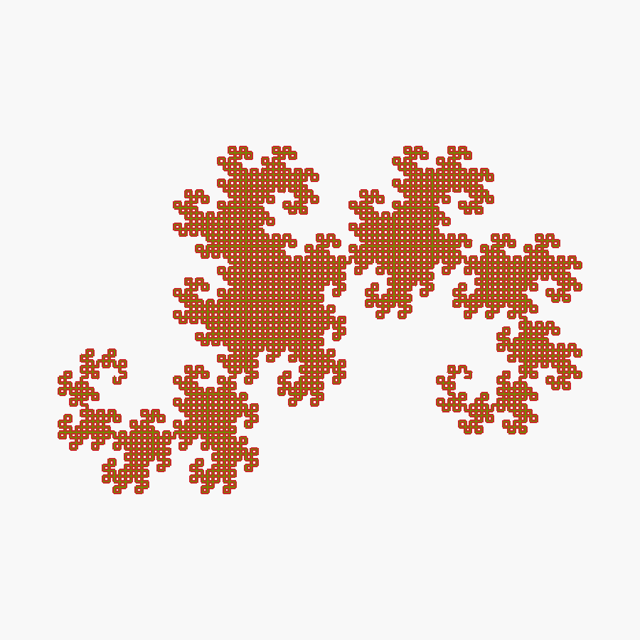
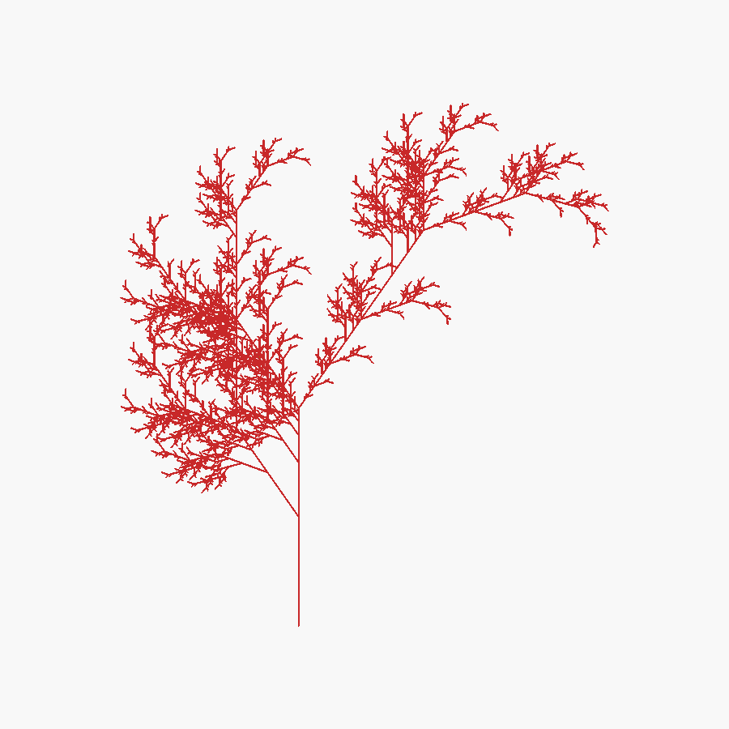
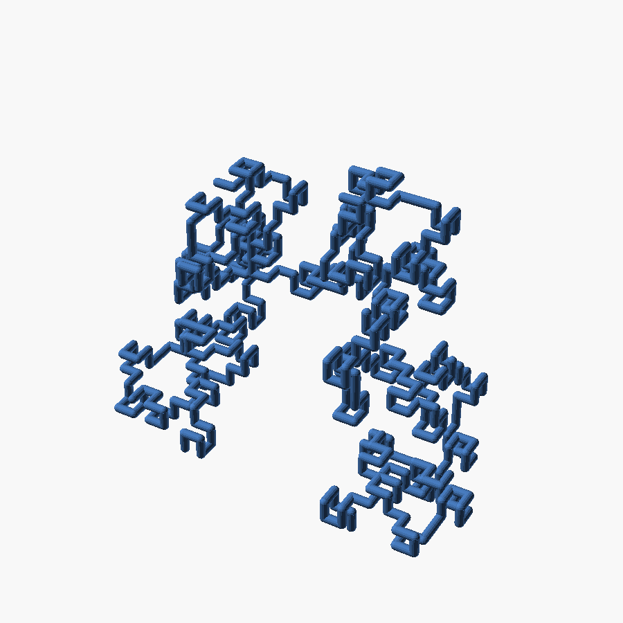
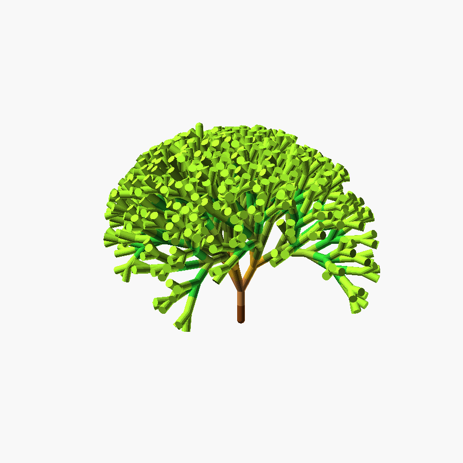
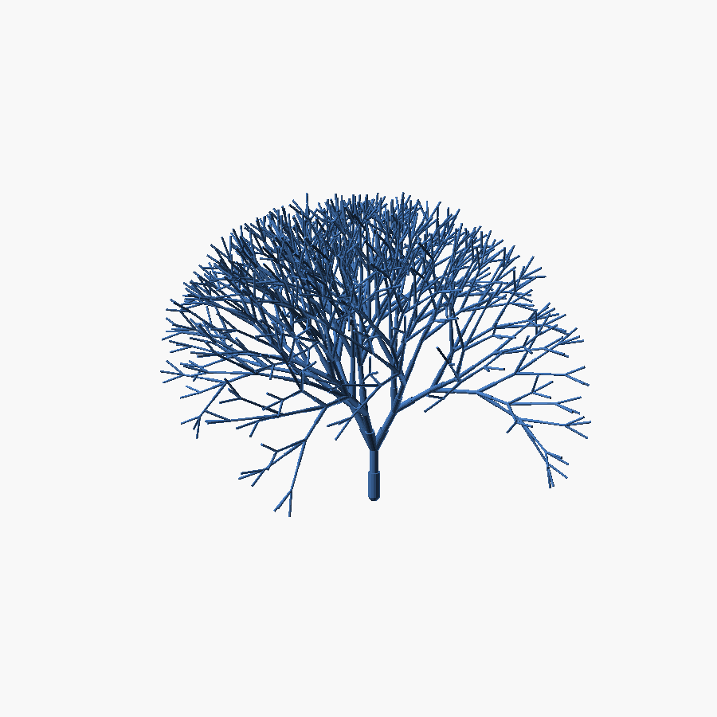
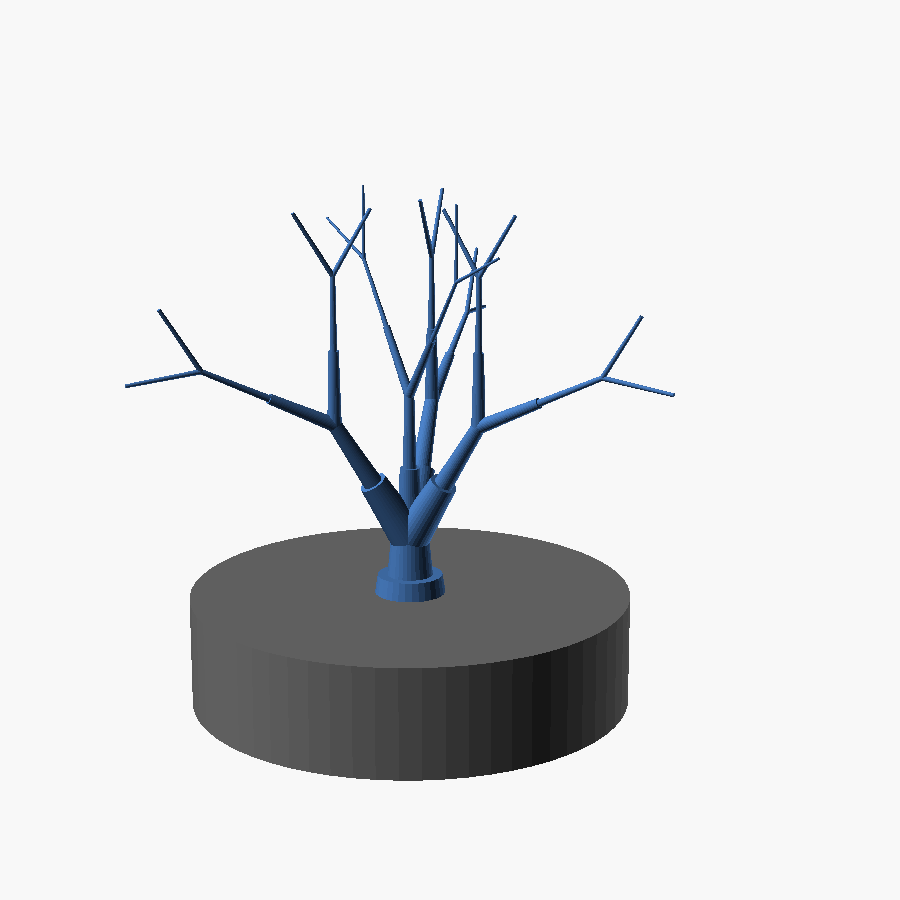
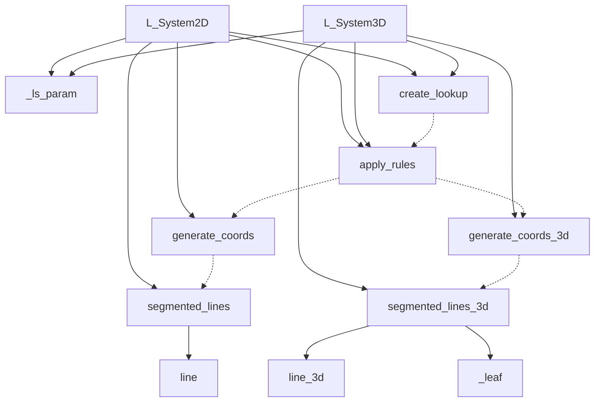

# l-system-scad

An L-system implementation in OpenSCAD. L-systems (Lindenmayer systems) are parallel rewriting systems and a type of formal grammar, commonly used to simulate plant growth and generate fractals.

## Overview

This library allows you to generate space-filling curves, fractal shapes, and 3D structures (plants, trees, corals, space-filling sculptures) by applying recursive replacement rules.

| | | |
| --- | --- | --- |
|  |  |  |
| `dragon_curve` | `fractal_plant` | `hilbert_curve_3d` |
|  |  |  |
| `color_tree` | `weeping_tree` | `examples/printable_tree.scad` |

### Key Features

- **L-system functionality**: Create fractals and space-filling curves using recursive rule-based transformations.
- **2D and 3D turtles**: the same grammar draws as 2D lines, a filled polygon, or 3D tubes, branches and leaves.
- **Turtle graphics support**: Movement operations include forward drawing ("F"), move without drawing ("M"), and rotation ("+" and "-").
- **Position saving and restoring**: Use "[" and "]" to save and restore the turtle's position and orientation during rule application.
- **A catalog of over 100 grammars**: fractal curves, tilings, plants and 3D trees, each with tuned defaults.

## Operations Supported

- `"F"`: Moves the turtle forward by one unit and draws a line segment.
- `"M"`: Moves the turtle forward without drawing (useful for non-drawing paths, e.g., `island_curve` example).
- `"+"`: Rotates the turtle to the right by the specified angle (default is 90 degrees).
- `"-"`: Rotates the turtle to the left by the specified angle (default is 90 degrees).
- `"["`: Saves the current turtle state to the stack.
- `"]"`: Restores the turtle state from the stack.

`L_System3D` extends the alphabet with the ABOP-standard 3D symbols (in 3D, `+`/`-` yaw about the turtle's up vector):

- `"&"` / `"^"`: Pitch down / up about the left vector.
- `"\"` / `"/"`: Roll left / right about the heading (write roll-left as `"\\"` in rule strings).
- `"|"`: Turn around (yaw 180 degrees).
- `"!"`: Multiply the current segment width by the `taper` factor (saved/restored by `[` and `]`).
- `"{"` / `"."` / `"}"`: Open a polygon / record the current position as a vertex / close and fill the polygon. Fills a leaf or petal as a thin surface (thickness set by `leaf_thickness`). One polygon at a time (no nesting); vertices recorded inside `[` `]` branches still belong to the open polygon.
- `";"` / `","`: Increment / decrement the color index into the `palette` (saved/restored by `[` and `]`). Preview only — see below.

`L_System3D` also supports three parameter-driven growth behaviors (no new symbols):

- **Tropism** — bend the heading toward a fixed direction after each segment, per ABOP (`alpha = e*|H x T|`). Set via `tropism` (direction, e.g. `[0, 0, -1]` for gravity) and `tropism_strength` (`e`). Models drooping, climbing, wind-swept growth.
- **Directed growth** — bend toward `attract_points` and away from `repel_points` (point-based tropism, reusing `tropism_strength`). Models growth toward light or nutrients.
- **Color** — supply a `palette` (list of colors); the `;` / `,` symbols index into it for per-level or per-branch coloring. **Preview only**: OpenSCAD strips color on F6 render and on STL/AMF/3MF export, so this is a screenshot/documentation feature, not colored fabrication data.
- **Tapered branches** — `branch_taper` (a per-segment width multiplier < 1) draws each branch as a cone that narrows along its length, with child branches inheriting the parent's tip diameter. Set `$ls_rounded = false` to drop the sphere joints for clean cone-to-cone transitions — good for printable trees. Default 1 (uniform cylinders).

Rules can also be **stochastic**: a rule's right-hand side may be a list of weighted options `["A", [[0.5, "..."], [0.5, "..."]]]` instead of a single `"A=..."` string, and each occurrence picks one at random. Choices are seeded by `$ls_seed` (default 1) so a render is reproducible; change `$ls_seed` for a different structure from the same grammar.

The 3D turtle starts at the origin heading +Z. If your L-system rules use different symbols than the default "F" for forward or "M" for move, you can specify custom characters using the `draw_chars` and `move_chars` parameters. An extensive range of examples can be found under `examples` folder.

## Usage

Render a predefined curve from the catalog (its curated defaults ride along in the grammar tuple; explicit arguments override them):

```scad
use <l-system-scad/l_systems.scad>;

L_System2D(dragon_curve());
L_System2D(gosper_curve(), n = 3, w = 0.6);
linear_extrude(2) L_System2D(hilbert_curve(), n = 6, w = 1);
```

Render 3D structures — and because grammar tuples are dimension-free data, any 2D curve also renders as a 3D tube:

```scad
use <l-system-scad/l_systems.scad>;

L_System3D(whorl_tree());                 // tapered 3D tree
L_System3D(hilbert_curve_3d(), n = 4);    // 3D space-filling curve
L_System3D(dragon_curve(), w = 0.6);      // 2D grammar as a 3D tube
L_System3D(weeping_tree());               // gravity tropism (drooping)
L_System3D(leafy_sprig());                // filled polygon leaves
L_System3D(stochastic_tree(), $ls_seed = 3); // random branch patterns
L_System3D(color_tree());                 // per-level color gradient (preview)
L_System3D(reaching_tree());              // directed growth toward a point
```

A stochastic grammar and a directed-growth call written out:

```scad
use <l-system-scad/l_systems.scad>;

// each "A" randomly grows one of two branch patterns
L_System3D("FA",
    [[ "A", [[ 0.5, "!F[&FA]///[&FA]" ], [ 0.5, "!F[&&FA]///[FA]" ]] ]],
    n = 6, angle = 28, $ls_seed = 7);

// branches bend toward a point above and to the side (like a plant seeking light)
L_System3D(whorl_tree(), attract_points = [[ 40, 0, 45 ]], tropism_strength = 0.45);
```

Define a custom grammar (the catalog is not needed):

```scad
use <l-system-scad/l_system_2d.scad>;

L_System2D("FX", [ "X=X+YF+", "Y=-FX-Y" ], n = 12, angle = 90, w = 0.4);
```

Override library settings — these are `$`-special variables, so they work through `use`, per call or globally:

```scad
use <l-system-scad/l_systems.scad>;

$ls_rounded = false; // no rounded joints/caps (faster preview)
$ls_debug = true;    // echo intermediate tables/instructions/coords
$ls_seed = 5;        // master seed for stochastic rules (default 1)
$fn = 8;             // cap tessellation (library default: 16)

L_System2D(fractal_plant(), $ls_rounded = true); // per-call override
```

Note: OpenSCAD hoists top-level `$`-variable assignments (last one wins for the whole file), so set `$ls_seed` once per file — use a per-call `$ls_seed =` override to render several different stochastic trees in one file.

### Examples

The `examples/` folder holds runnable, Customizer-ready showcases (pick a curve from the dropdown in OpenSCAD's Customizer, or set `selected_curve`):

- `showcase_lines_2d.scad` / `showcase_poly_2d.scad` — the 2D line and polygon curves.
- `showcase_3d.scad` — the 3D grammars. Feature exemplars: `weeping_tree` (**tropism**), `leafy_sprig` (**filled leaves**), `stochastic_tree` (**random rules** — vary `$ls_seed`), `color_tree` (**per-level color**), `reaching_tree` (**directed growth**); it also renders 2D catalog grammars as 3D tubes.
- `usage_simple.scad`, `usage_predefined.scad`, `usage_override.scad` — minimal scripts for a custom grammar, a catalog curve, and the `$ls_*` settings.
- `printable_tree.scad` — a 3D tree on a round base with tapered cone branches, ready to print, with Customizer controls for depth, spread, taper, and base size. Preview (F5) is instant; F6/STL export of the unioned cones is slow, so export with patience or a lower `facets` value.

## Architecture

- **`l_systems.scad`** — umbrella entry point: includes the engine and the grammar catalog.
- **`l_system_core.scad`** — dimension-agnostic rewriting engine (`create_lookup`, `apply_rules`, helpers). Shared by the 2D and 3D interpreters.
- **`l_system_2d.scad`** — the 2D turtle interpreter and renderer (`L_System2D`, `generate_coords`, `segmented_lines`, `line`).
- **`l_system_3d.scad`** — the ABOP-style 3D turtle interpreter and renderer (`L_System3D`, `generate_coords_3d`, `segmented_lines_3d`, `line_3d`). Orientation is an H/L/U frame; segments render as cylinders with optional sphere joints.
- **`grammars.scad`** — pure-data curve catalog: each curve is a function returning a grammar tuple `[axiom, rules, params]`, where `params` is a list of `[key, value]` pairs carrying the curve's curated defaults (`angle`, `n`, and where non-default: `w`, `draw_chars`, `move_chars`, `heading`, `poly`, `taper`, `tropism`, `tropism_strength`, `leaf_thickness`, `palette`, `attract_points`, `repel_points`, `branch_taper`). `rules` entries may be deterministic `"X=ABC"` strings or stochastic `["X", [[weight, "..."], ...]]` lists. The same tuples feed both interpreters.

Every file contains only definitions (no top-level state), so each is standalone and works identically via `use` or `include`.

- **_Modules_**
  - **L_System2D** / **L_System3D**: High-level modules for generating an L-system based model. Both accept `(axiom, rules, ...)` or a grammar tuple.
  - **segmented_lines** / **segmented_lines_3d**: Draw segment lists (chunked; OpenSCAD silently skips module loops over 10000 elements).
  - **line** / **line_3d**: Draw a single segment (2D rectangle / 3D cylinder).
  - **_leaf**: Draws a filled polygon (leaf/petal) as a thin prism through a run of 3D vertices.
- **_Functions_**
  - **create_lookup**: Builds the two symbol tables expansion reads: what each symbol becomes on every pass but the last, and on the last pass, where drawing symbols become `F`, moving symbols `M`, the turtle's own symbols stay and the rest are dropped (optional `valid_chars` selects the turtle alphabet; supports weighted stochastic rules).
  - **apply_rules**: Expands the axiom n times, picking a random production per occurrence for stochastic rules (seeded by `$ls_seed`).
  - **generate_coords** / **generate_coords_3d**: Convert instructions into coordinates / a tagged list of `["seg", start, end, width]` segments and `["leaf", [vertices]]` polygons. `generate_coords_3d` is usable standalone for path-extrusion workflows.
  - **\_ls_param**: Looks up a key in a grammar tuple's params list.



## Development

### Changelog Highlights

- **Pure-data grammar catalog**: predefined curves are now plain functions returning `[axiom, rules, params]` tuples; the per-curve wrapper modules were removed. `dragon_curve(n = 12)` becomes `L_System2D(dragon_curve(), n = 12)`.
- **`$ls_*` settings**: the `USER_ROUNDED`/`USER_FN`/`USER_DEBUG` include-only override pattern was replaced by dynamically scoped `$ls_rounded`/`$ls_debug` special variables that also work through `use` and per call. The library no longer sets `$fn` globally.
- **Rewritten engine and turtles**: the rewriting engine and both turtle walks are new code, MIT-licensed. Every catalog grammar expands and draws exactly as before (see Checks). The turtles keep saved states as a linked list, so a push or pop costs the same at any depth. The string helpers `join`, `substr`, `sublist` and `in_list` are gone.
- **3D turtle**: `L_System3D`, with tropism, directed growth, leaves, colour and tapered branches.
- **Stochastic rules**: weighted, seeded, repeatable.

### Future Work

Natural extension points, in their obvious homes (rewriting-level features belong in `l_system_core.scad`, interpretation-level in the interpreter files):

- Parametric (parameter-carrying) rules (core)
- Nested polygons and predefined-surface instancing (the ABOP `~` symbol; note this clashes with Houdini/TouchDesigner, where `~` means a random rotation) (3D interpreter)
- Distance-weighted attractor falloff for directed growth (3D interpreter)
- Colored fabrication output (needs a newer OpenSCAD with lazy-union + 3MF materials)

## Notes

The models generated by this library can increase in complexity exponentially with higher iteration values. Be cautious with increasing the value of 'n', as large values may cause the program to hang or consume large amounts of memory (RAM). A recommended maximum 'n' value has been provided for each curve, with limitations due to OpenSCAD's 1,000,000 iteration limit for "C-style" for loops.

### Curves

For 2D curves it's recommended to **USE F6 RENDER**, as this provides better performance compared to F5 rendering. For 3D models the opposite holds: F5 preview handles tens of thousands of segments in seconds, but F6/CSG rendering (and STL export) of that many unioned cylinders is far slower — keep `n` at the recommended values, and set `$ls_rounded = false` to skip sphere joints (30-60% faster) on large models.

For more details on L-systems, visit [L-System Wikipedia](https://en.wikipedia.org/wiki/L-system).

## References

The 3D turtle, tropism, and leaf/polygon features follow the canonical L-system formalism:

- Prusinkiewicz, P. & Lindenmayer, A. (1990). _The Algorithmic Beauty of Plants_ (ABOP). Springer-Verlag. Freely available at [algorithmicbotany.org](http://algorithmicbotany.org/papers/#abop). Source for the turtle interpretation of strings (§1.3), the 3D H/L/U orientation frame (§1.5), the tropism formula `α = e·|H × T|` (§2), and the `{ } .` polygon/surface symbols (§5.2).
- The 3D Hilbert curve grammar (`hilbert_curve_3d`) is from Stan Wagon, _Mathematica in Action_ (1991), as tabulated by Robert Dickau, [3-D L-Systems](http://www.robertdickau.com/lsys3d.html).
- The 3D turtle symbol alphabet was cross-checked against the [Houdini L-System SOP](https://www.sidefx.com/docs/houdini/nodes/sop/lsystem.html) and [TouchDesigner LSystem SOP](https://docs.derivative.ca/LSystem_SOP) documentation. Note the `~` symbol clash: ABOP uses it for predefined-surface instancing, while Houdini/TouchDesigner use it for random reorientation.

## Checks

`just test` takes about 11 s on OpenSCAD 2026.10.15. It checks:

- segment counts that follow from the rules: the dragon curve has 2^n segments, the Hilbert curve 4^n − 1, the Koch snowflake 3·4^n points;
- the turtle closing a square, returning from nested branches, and moving without drawing;
- symbol mapping, the first rule for a symbol winning, and stochastic rules repeating for a seed, changing with it and drawing in proportion to their weights;
- the 3D turtle: unit steps however the frame turns, pitch direction, tropism, branch taper and leaves;
- every grammar in the catalog, through both turtles, against its fingerprint in `tests/fingerprints.txt` (`just fingerprints` rewrites it after an intended change);
- every example file evaluating without warnings, and malformed input stopping with its message.

`just images` renders the pictures above.

## Acknowledgment

This library began as an extension of the [L-system OpenSCAD library by Hans Loeblich](https://gist.github.com/thehans/a1494db8046a58832e2ebb10a5908a66), and I'm grateful to Hans for his contributions to the OpenSCAD community, which shaped many of my own libraries and designs. The current engine and turtles are a rewrite. Many grammars in the catalog come from [tecnoloxia](https://github.com/tecnoloxia)'s 100hex project; they're marked `src: 100hex` in `grammars.scad`.

## Licence

MIT; see [LICENSE](LICENSE).
